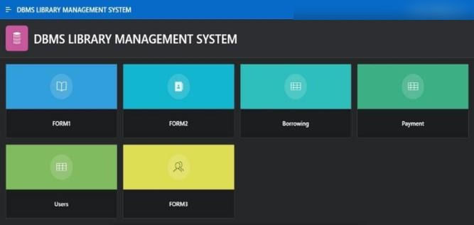
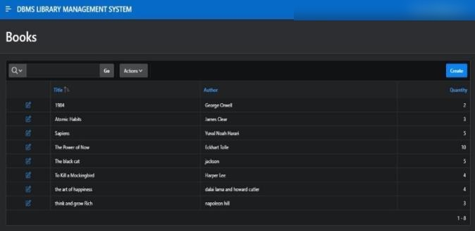
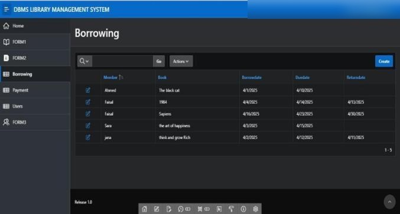
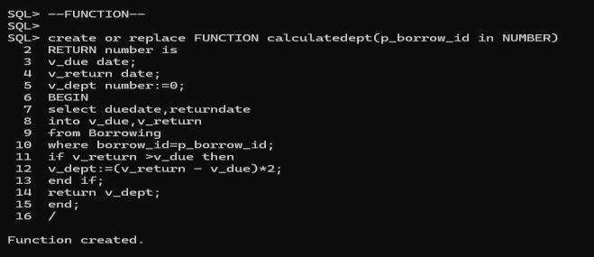

# Library Management System

A relational database for managing a library's books, members, borrowing, returns, and late-fee payments, built with **Oracle SQL, PL/SQL, and Oracle APEX**.

> Team project, Database Management course (IS221T), Princess Nourah bint Abdulrahman University, Spring 2025.

## Features

- **Relational schema** with 5 tables (Books, Members, Borrowing, Users, Payment) linked by foreign keys
- **Trigger** that blocks borrowing a book when it is out of stock
- **Procedure** that records a book return
- **Function** that calculates the late-return fee
- **Query optimization** using an index, `EXISTS`, and `EXPLAIN PLAN`
- **Role-based access control** with four roles: Admin, Moderator, Member, Guest
- **Oracle APEX interface** with forms and reports

## My Role

- **Team leader** of the 4-member team
- Built the **Moderator** role: created the user and role, and granted its privileges on books, members, and borrowing records

## Project Structure

| File | Contents |
|---|---|
| `sql/01_create_tables.sql` | Table definitions and constraints |
| `sql/02_sample_data.sql` | Sample data |
| `sql/03_trigger.sql` | Trigger that prevents borrowing unavailable books |
| `sql/04_procedure.sql` | Procedure for returning a book |
| `sql/05_function.sql` | Function that calculates late fees |
| `sql/06_queries_optimization.sql` | Queries, before/after optimization |
| `sql/07_users_roles.sql` | Users, roles, and privileges |
| `docs/Project_Report.pdf` | Full project report with outputs |

## How to Run

Run the files in order (01 → 07) in Oracle SQL*Plus or SQL Developer.

## Screenshots

| Books report | Borrowing report |
|---|---|
|  |  |

Late-fee function output:

## Team

Lina Alsarhan, Wajd Alamri, Reema Alanazi, Rawda Alsuwairi
